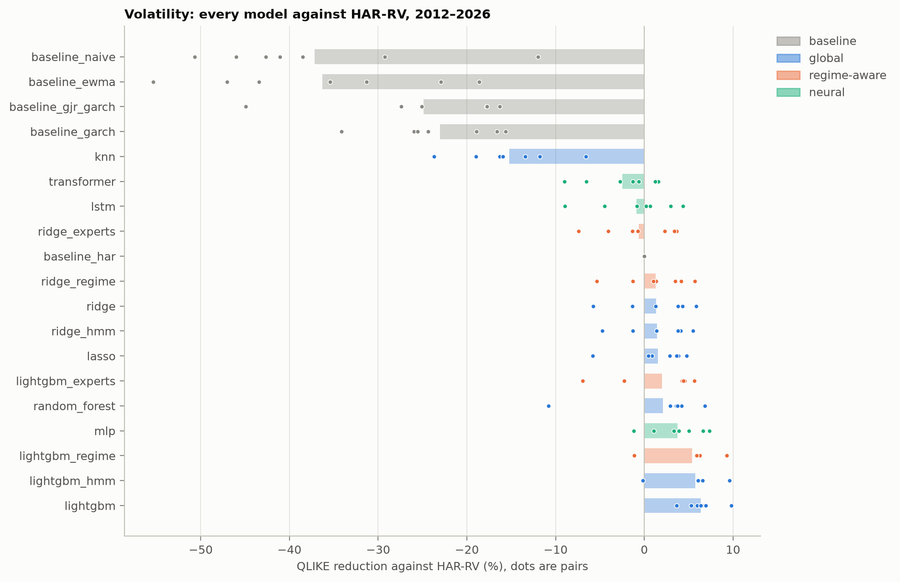

# Regime-aware learning of returns and volatility in G10 FX

What can be predicted in currency markets, when is it predictable and is it worth money? This project tests that on seven major currency pairs (EUR/USD, GBP/USD, USD/JPY, USD/CHF, AUD/USD, USD/CAD and NZD/USD) from 2006 to October 2026. Every model is refitted month by month and tested out of sample from January 2012 against a benchmark, with a significance test behind every claim. It is our project for BITS F464 Machine Learning at BITS Pilani K K Birla Goa Campus.

- **Results dashboard:** [`reports/dashboard.html`](reports/dashboard.html), opened from your clone in any browser (GitHub shows it as source code; it works offline)
- **Proposal:** [`docs/proposal/ML_proposal.pdf`](docs/proposal/ML_proposal.pdf)
- **Plan and progress:** [`PLAN.md`](PLAN.md)

## Results at a glance

| Research question | Answer |
|---|---|
| **RQ1** Can machine learning beat GARCH and HAR-RV at forecasting volatility? | **Yes, at one day.** LightGBM's QLIKE loss is 6.1% below HAR-RV's, significantly lower on 5 of 7 pairs; GARCH is 23% worse than HAR-RV. Over 5 and 22 days HAR-RV wins. |
| **RQ2** Is the direction of tomorrow's return predictable? | **No.** The best average AUC is 0.507. No model's up/down calls beat chance on more than 1 of 7 pairs and no return forecast beats a zero forecast. |
| **RQ3** Do regimes exist and do regime-aware models do better? | **Regimes yes, models no.** A calm and a turbulent regime emerge (next-day volatility of 8.7% and 10.9% a year), but adding regimes to a model helps significantly in 4 pair-model comparisons and hurts in 16. |
| **RQ4** Do forecast gains survive trading costs? | **No for trading.** No direction signal makes money after costs (Sharpe ratios from −0.51 to −0.16); carry earns 0.24, not significant. Better volatility forecasts do give more reliable Value at Risk. |
| **RQ5** Generative or discriminative classifier as data grows? | **Generative first, then discriminative.** Naive Bayes ranks days better with up to 252 days of data; logistic regression leads from 504 days. |

Beyond the seven majors: on EUR/GBP the learning models only match HAR-RV. USD/INR is the one pair whose up/down calls beat chance, but no strategy on it earns a significant profit after costs.



*QLIKE reduction against HAR-RV for every volatility model; bars are the average over pairs and dots are single pairs. LightGBM and the MLP gain the most, while the GARCH-type and naive baselines lose 23% to 37%.*

## Browsing the results

Nothing needs to be run to read the results.

- **Dashboard** ([`reports/dashboard.html`](reports/dashboard.html), opened from your clone): **Verdicts** shows every model against its benchmark pair by pair, next to the five research questions; select any cell for the test behind it. **Explorer** covers every result: scorecards, horizons, regimes, the backtest, Value at Risk, learning curves, calibration, features, the extra pairs and the data checks. **Present** has ten slides for a talk, moved with the arrow keys. The same views run as a Streamlit app with `uv run --group dashboard streamlit run dashboard/app.py`.
- **Notebooks** (with their outputs saved):

  | Notebook | Contents |
  |---|---|
  | [`01_data_quality`](notebooks/01_data_quality.ipynb) | Coverage, gaps and agreement with the Federal Reserve's H.10 rates |
  | [`02_stylized_facts`](notebooks/02_stylized_facts.ipynb) | Fat tails, volatility clustering and autocorrelation |
  | [`03_baselines`](notebooks/03_baselines.ipynb) | Random walk, EWMA, GARCH, HAR-RV and ARIMA baselines |
  | [`04_regimes_factors`](notebooks/04_regimes_factors.ipynb) | Market regimes and currency factors |
  | [`05_classical_ml`](notebooks/05_classical_ml.ipynb) | Classical machine learning against the baselines, and RQ5 |
  | [`06_neural_networks`](notebooks/06_neural_networks.ipynb) | MLP, LSTM and Transformer |
  | [`07_backtest_risk`](notebooks/07_backtest_risk.ipynb) | Trading strategies, Value at Risk and SHAP explanations |
  | [`08_extensions`](notebooks/08_extensions.ipynb) | Calibration, hidden Markov regimes and longer horizons |
  | [`09_stretch_goals`](notebooks/09_stretch_goals.ipynb) | EUR/GBP, USD/INR and the dashboard |

- **Tables and figures:** every number is saved in [`reports/tables`](reports/tables) and every chart in [`reports/figures`](reports/figures).

## Method in brief

- **Data:** HistData 1-minute bars turned into 5-minute bars and daily realized variance, with each trading day running from 17:00 to 17:00 New York time. VIX, the broad dollar index, Brent crude and the H.10 exchange rates come from FRED and policy rates from the BIS. Gold and the S&P 500 serve as context.
- **Targets:** next-day realized variance, the direction of the next day's return and its size.
- **Validation:** an expanding walk-forward window with monthly test blocks from January 2012. Training rows whose target falls in the test month are purged and the last 20% of each window, after a 5-day embargo, is used for tuning. Automated tests change future data and check that past forecasts do not move.
- **Models:**
  - baselines: random walk, historical mean, EWMA, GARCH, GJR-GARCH, HAR-RV and ARIMA;
  - classical: ridge, lasso, kNN, random forest, LightGBM, logistic regression, Naive Bayes, decision tree and SVMs;
  - neural: an MLP, an LSTM and a small Transformer;
  - regime-aware versions that add Gaussian mixture or hidden Markov regime probabilities, or train one expert per regime.
- **Tests:** Diebold–Mariano against each task's benchmark, Pesaran–Timmermann for up/down calls, Kupiec and Christoffersen for Value at Risk, and Newey–West for strategy returns.
- **Backtest:** next-day returns plus the interest differential, half the bid-ask spread per trade (also run at twice the cost), volatility targeting and an equal-risk portfolio of the seven pairs.

## Getting started

You need [uv](https://docs.astral.sh/uv/), which also installs Python 3.12. On macOS install it with `brew install uv` and add `brew install libomp` for LightGBM.

```bash
git clone https://github.com/Aditya-00786/ML-Project_fx-forecasting.git
cd ML-Project_fx-forecasting
uv sync            # Python 3.12 and the exact locked packages, in .venv
uv run pytest      # about 200 tests, using synthetic data
```

Run any script or notebook through `uv run`, for example `uv run jupyter lab`. Add `--group dashboard` to `uv sync` for the Streamlit app.

If you clone into a Mac folder synced by iCloud (Desktop or Documents with iCloud Drive), keep iCloud away from the environment and the data. Otherwise it hides files inside `.venv`, which breaks imports, and tries to upload gigabytes of data:

```bash
UV_PROJECT_ENVIRONMENT=.venv.nosync uv sync && ln -s .venv.nosync .venv
mkdir data.nosync && ln -s data.nosync data
```

## Reproducing everything

Data is never committed. It is downloaded from free public sources and rebuilt in `data/`, which takes about 0.25 GB because the 1-minute bars are kept as 5-minute bars and raw files are never stored. The model runs save their forecasts in `reports/predictions/`, so tables and figures can be rebuilt without retraining. Run the steps in this order:

| Step | Command | Writes |
|---|---|---|
| 1 | `uv run python scripts/download_data.py` | HistData, FRED and BIS data (about 0.7 GB downloaded; resumable) |
| 2 | `uv run python scripts/build_dataset.py` | daily bars, macro series and policy rates |
| 3 | `uv run python scripts/check_data.py` | coverage and H.10 agreement checks |
| 4 | `uv run python scripts/build_features.py` | features and next-day targets |
| 5 | `uv run python scripts/run_baselines.py` | `reports/tables/baselines_*.csv` |
| 6 | `uv run python scripts/run_regimes.py` | regimes, hidden Markov regimes and currency factors |
| 7 | `uv run python scripts/run_ml.py --workers 8` | classical models, `reports/tables/ml_*.csv` |
| 8 | `uv run python scripts/run_learning_curves.py` | Naive Bayes against logistic regression (RQ5) |
| 9 | `uv run python scripts/run_neural.py --workers 8` | MLP, LSTM and Transformer, three seeds each |
| 10 | `uv run python scripts/run_backtest.py` | strategies, breakdowns and Value at Risk |
| 11 | `uv run python scripts/run_shap.py` | SHAP values of the LightGBM models |
| 12 | `uv run python scripts/run_horizons.py` | 5 and 22 day forecasts |
| 13 | `uv run python scripts/build_extra_pairs.py` | EUR/GBP and USD/INR data |
| 14 | `uv run python scripts/run_extra_pairs.py --workers 8` | their forecasts, backtest and Value at Risk |
| 15 | `uv run python scripts/build_dashboard.py` | `reports/dashboard.html` and `reports/dashboard/data.json` |

The download takes about 25 minutes and the baselines about 10. The classical models take about 3 hours of CPU time and the neural networks several hours; both use all the workers they are given and resume where they stopped. The data sources may revise past values, so a rebuild can differ very slightly from the saved tables, which are the record of our results.

## Repository layout

```
ML-Project_fx-forecasting/
├── configs/default.yaml   pairs, dates, walk-forward settings and cost assumptions
├── src/fxml/
│   ├── data/              downloaders (HistData, FRED, BIS), bars, daily panel, quality checks
│   ├── features/          returns, technical indicators, volatility and walk-forward GARCH
│   ├── regimes/           market state, clustering, hidden Markov model and regime evaluation
│   ├── models/            baselines, classical models, neural networks, horizons, comparison
│   ├── validation/        walk-forward folds, metrics and statistical tests
│   ├── backtest/          strategies, performance and Value at Risk
│   ├── dashboard/         the results dashboard (data, scorecards, page)
│   ├── factors.py         currency factors (PCA)
│   ├── extra_pairs.py     EUR/GBP and USD/INR
│   └── interpret.py       SHAP explanations
├── scripts/               one command per pipeline step (see the table above)
├── notebooks/             results notebooks 01 to 09
├── dashboard/app.py       the Streamlit app
├── reports/               tables, figures and the dashboard page
├── tests/                 automated checks, including look-ahead tests
├── docs/proposal/         the project proposal
└── PLAN.md                the implementation plan and its progress
```

## Tests

`uv run pytest` runs about 200 tests on synthetic data, so they need no downloads. They include look-ahead tests for every feature, model and regime method: each one changes data after a cutoff and checks that nothing before it moves. GitHub Actions runs the linter and the tests on every pull request and every push to `main`.

## Data sources

All data is free and needs no account or API key:

- [HistData.com](https://www.histdata.com/): 1-minute bars for the currency pairs, gold and the S&P 500;
- [FRED](https://fred.stlouisfed.org/): VIX, the broad dollar index, Brent crude and the H.10 exchange rates (including USD/INR);
- [BIS](https://data.bis.org/): central bank policy rates.
